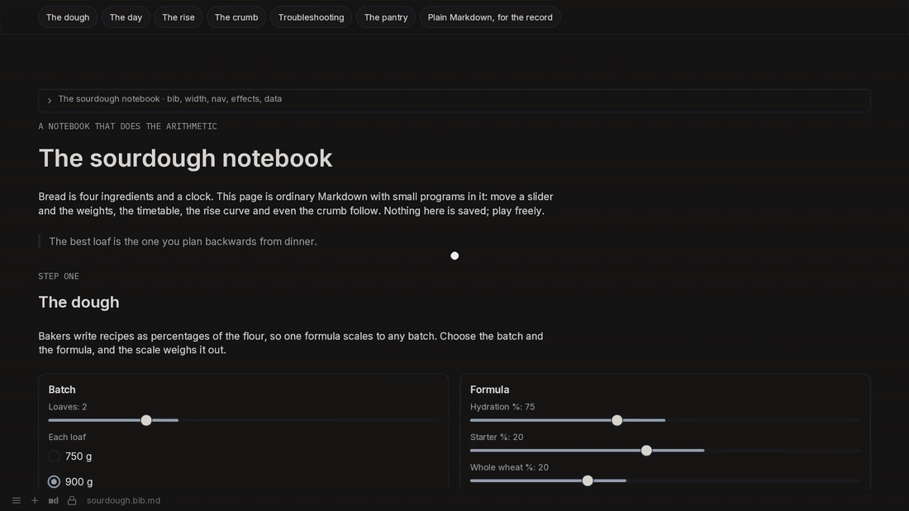

# bibmd

A zen Markdown reader that edits a block in place when it is clicked, and runs the small
programs in it. Built on [bibui](https://navisurgvision.com/bibui/); Wayland, one Native AOT
binary for x86_64 Linux, no runtime.



## What it does

- **Reads quietly.** Markdown is drawn as one calm column: headings, lists, tables, code,
  images, Mermaid diagrams. Move through it block by block with vim keys (`j` `k`, `gg` `G`,
  `{` `}`), or scroll.
- **Edits in place.** Click a block, or press `Enter`, and it turns into its Markdown source
  right where it was, with vim's Normal and Insert modes. `Escape` puts it back rendered and
  writes the file. Undo goes through every version of the file this session.
- **Runs bib blocks.** A fenced ` ```bib ` block is a small program drawn live: sliders,
  choices, toggles, stats, tables, checklists, charts, and shapes drawn from boxes, lines and
  circles. Move a slider and everything that depends on it recomputes, including the blocks
  further down the page.
- **Follows your Omarchy theme.** On [Omarchy](https://omarchy.org) the window takes its
  colours from the desktop's theme and crossfades to the new one when you switch. `t`
  switches to the built-in light or dark theme and back.
- **Checks a notebook headless.** `md notebook.bib.md --check` runs every bib block without
  a window and prints each error at its line in the file.

## Try it

The notebook in the video is a sourdough planner: the dough calculator, the bake's
timetable, the rise curve, a guess at the crumb and a troubleshooting list, all from
your sliders. [Download sourdough.bib.md](https://github.com/relu24/bibmd-releases/releases/latest/download/sourdough.bib.md)
and open it:

```sh
md sourdough.bib.md
```

The package also installs it, as `/usr/share/doc/bibmd/examples/sourdough.bib.md`. Copy it
somewhere of your own first, because opening a block edits the file.

Press `?` in the window for every key.

## Built on bibui

Everything in the window, the reader, the editor and every slider, chart and shape a bib
block draws, is drawn by [bibui](https://navisurgvision.com/bibui/), an immediate-mode UI
library for .NET from Navisurg Vision. Its rasterizer, written in C#, is why bibmd is a
single native binary. To build your own app on it, start with
[the bibui documentation](https://navisurgvision.com/bibui/).

## Install

### Arch Linux

Add the pacman repository to `/etc/pacman.conf`:

```ini
[bibmd]
SigLevel = Optional TrustAll
Server = https://github.com/relu24/bibmd-releases/releases/download/repo
```

then

```sh
sudo pacman -Sy bibmd-bin    # or: yay -S bibmd-bin
```

`pacman -Syu` keeps it up to date. It installs `bibmd` and `md`: `md notes.md` opens (or
creates) a file.

### Other distributions

Download `bibmd-<version>-x86_64.tar.gz` from the [releases](https://github.com/relu24/bibmd-releases/releases)
and put `bibmd` on your PATH. It needs wayland, libxkbcommon, freetype, harfbuzz and fontconfig.
The tarball has `sourdough.bib.md` in it too.

## License

MIT. The embedded iA Writer Mono S font is under the SIL Open Font License (OFL.txt in each tarball).
